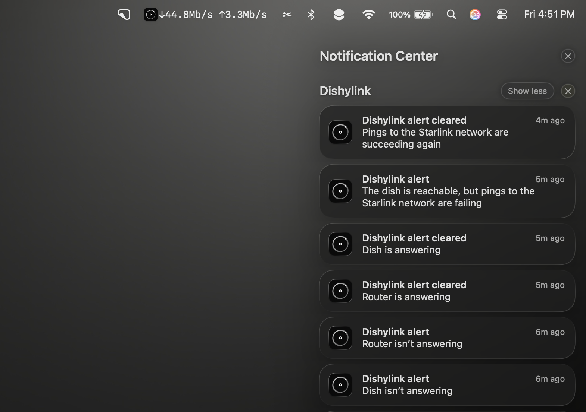
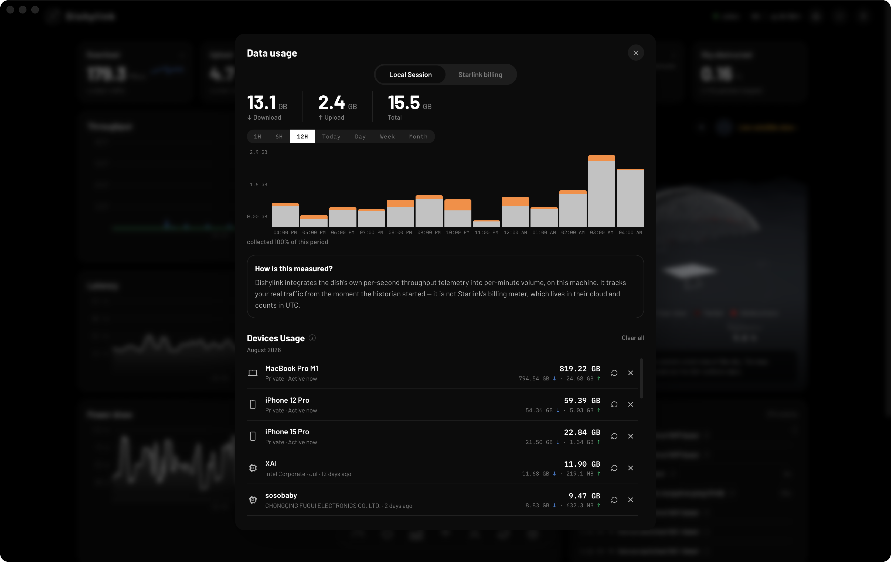
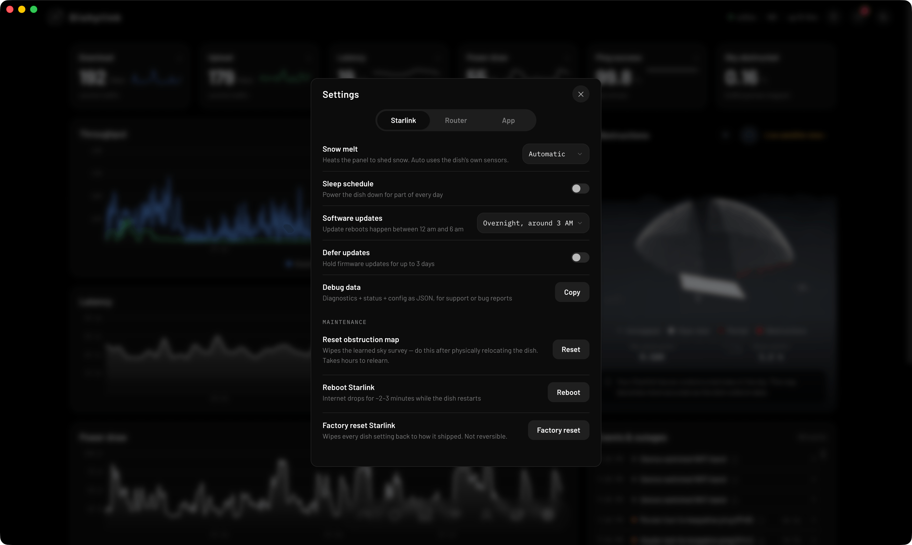
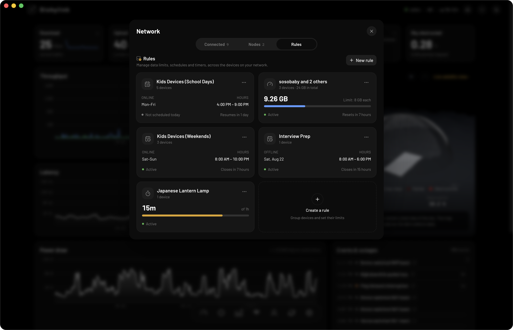

There is a Starlink app for Mac. It is called Dishylink, and it is free. It shows your live Starlink speeds in the menu bar, sends alerts to Notification Center and keeps a history of your connection.

SpaceX does not make a native Mac app. The official Starlink app is built for phones and tablets. This guide explains how to use Dishylink on a Mac and covers the other ways to manage Starlink from macOS.

Dishylink is our app. The details about Starlink's own pages and the App Store listing were checked in November 2026.

## Quick summary

- Dishylink is a free Starlink app for macOS 12 and later. It runs on both Apple silicon and Intel Macs.
- The official Starlink app for iPad can be installed on Apple silicon Macs running macOS 26 or later.
- Your dish has a basic status page at `192.168.100.1`.
- Billing, plan changes and support are handled at starlink.com.

## 5 ways to manage Starlink on a Mac

| Method                   | Works on                                   | Best for                               |
| :----------------------- | :----------------------------------------- | :------------------------------------- |
| 1. Dishylink             | macOS 12 or later, Apple silicon and Intel | Monitoring, history and control        |
| 2. The official iPad app | Apple silicon Macs on macOS 26 or later    | Setup and settings in the official app |
| 3. The dish status page  | Any browser                                | Checking that the dish is online       |
| 4. Your Starlink account | Any browser                                | Billing, plan and support              |
| 5. Command-line tools    | Terminal                                   | Building your own dashboards           |

## 1. Dishylink (recommended)

[Dishylink](/) is a free, open-source app for macOS. It connects to your dish and router directly over your home network. It does not need an account, and the data it records stays on your Mac.

### Live throughput in the menu bar

Dishylink can show your live download and upload speed in the macOS menu bar, next to the clock. Click the Dishylink icon in the menu bar and choose Show Throughput in Menu Bar. The readout keeps updating when the app window is closed.

### Mac features

- Alerts in Notification Center when the dish or router stops responding, overheats or is affected by weather
- Keeps recording in the background after you close the window
- Can start at login
- Separate builds for Apple silicon and Intel

### What Dishylink shows

- Speed, latency, power draw, ping success and sky obstruction, live and by day, week or month
- Starlink latency and router latency on the same chart
- Every device on your network, with its Wi-Fi band, signal strength and data usage
- Your obstruction map and a live 3D view of the satellites overhead

### What you can control

- Snow melt: automatic, always on or off
- Sleep schedule: power the dish down for part of every day
- Software updates: choose the time window for update reboots, or defer updates for up to 3 days
- Maintenance: reboot the dish, reset the obstruction map, stow or unstow motorised kits, and factory reset
- Router: Wi-Fi network names and bands, custom DNS, bypass mode, router reboot and factory reset
- Devices: pause and unpause any device on your network

### Network rules

- Data limits for one device or a group of devices
- Schedules that allow a device online only during set hours
- Timers that give a device access for a set length of time

### How to install Dishylink on a Mac

1. [Download Dishylink for Mac](/#get). Choose `arm64` for Apple silicon (M1 and later) or `x64` for Intel.
2. Open the downloaded file and move Dishylink to your Applications folder.
3. Open Dishylink. macOS will block it the first time, because the Mac build is not yet signed with an Apple Developer ID.
4. Close the warning, then go to System Settings › Privacy & Security.
5. Scroll to Security and click Open Anyway next to the Dishylink message.

You only need to allow the app once.

### Limitations

- First-time setup of a new Starlink kit still requires the official Starlink app.
- Some controls, including pausing devices and network rules, require signing in to your Starlink account. Monitoring works without an account.

## 2. The official Starlink app for iPad

The App Store lists the official Starlink app for Mac as well as for iPhone and iPad. It is the iPad version of the app. Apple labels it "Designed for iPad. Not verified for macOS."

### Requirements

- A Mac with an M1 chip or later
- macOS 26 or later

Intel Macs cannot run it.

### What to expect

- You sign in with your Starlink account and get the same app as on an iPad, including setup.
- The app is designed for touch and opens in an iPad-sized window.
- It does not add anything to the menu bar.

## 3. The dish status page (192.168.100.1)

Starlink dishes used to serve a full web portal at this address. Starlink abandoned it in 2024. A small diagnostics page is all that remains.

### How to open it

1. Connect your Mac to your Starlink network.
2. Open Safari or another browser.
3. Go to `http://192.168.100.1`.

### What the page shows

On a dish running the October 2026 software, the page shows whether the dish is online, its uptime, alignment, obstruction map and software version. It also has a Reboot button and a message recommending the Starlink app.

The page does not show speed, latency, data usage or history.

## 4. Your Starlink account (starlink.com)

Sign in at starlink.com to manage your plan, billing and payment details, orders and support. The account pages do not show live information about your dish or your network.

## 5. Command-line tools

[starlink-grpc-tools](https://github.com/sparky8512/starlink-grpc-tools) is a set of open-source Python scripts that read the dish's local data from Terminal. The scripts can output text or CSV, or send the data to InfluxDB, SQLite, MQTT or Prometheus.

The tools do not have a graphical interface. You build the charts yourself, usually with Grafana.

## Which option is best?

- For everyday monitoring and control on a Mac, use Dishylink.
- For setup, or a setting that is only in the official app, use the official iPad app if your Mac supports it. Otherwise use the app on your phone.
- To check that the dish is online, open `192.168.100.1`.
- For billing, plan changes and support, use starlink.com.

## Frequently asked questions

### Is there a Starlink app for Mac?

Yes. Dishylink is a free app for macOS 12 and later, on both Apple silicon and Intel Macs. SpaceX's official app is an iPad app that can also be installed on Apple silicon Macs running macOS 26 or later.

### Does Starlink work on a Mac without an app?

Yes. A Mac connects to Starlink over Wi-Fi or Ethernet like any other network. An app is only needed to monitor the connection or change settings.

### Why does macOS say Dishylink cannot be opened?

The Mac build is not yet signed with an Apple Developer ID. Open the app once, then allow it under System Settings › Privacy & Security. The full steps are in the installation section above.

### Does Dishylink track me?

No. Dishylink has no telemetry, analytics or tracking. It reads your dish and router on your own network, and the data it records stays on your Mac. The code is available on [GitHub](https://github.com/DaveyHert/dishylink).
