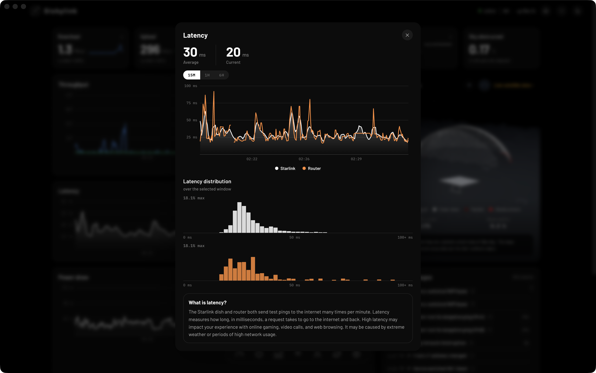
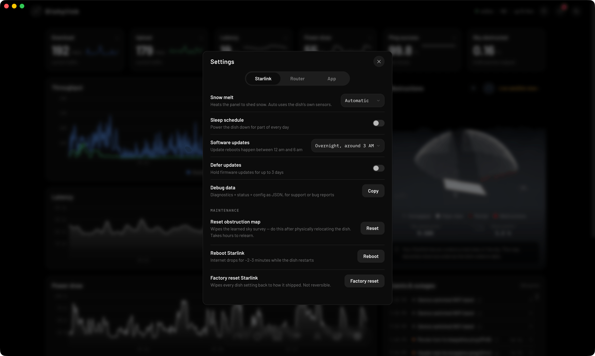
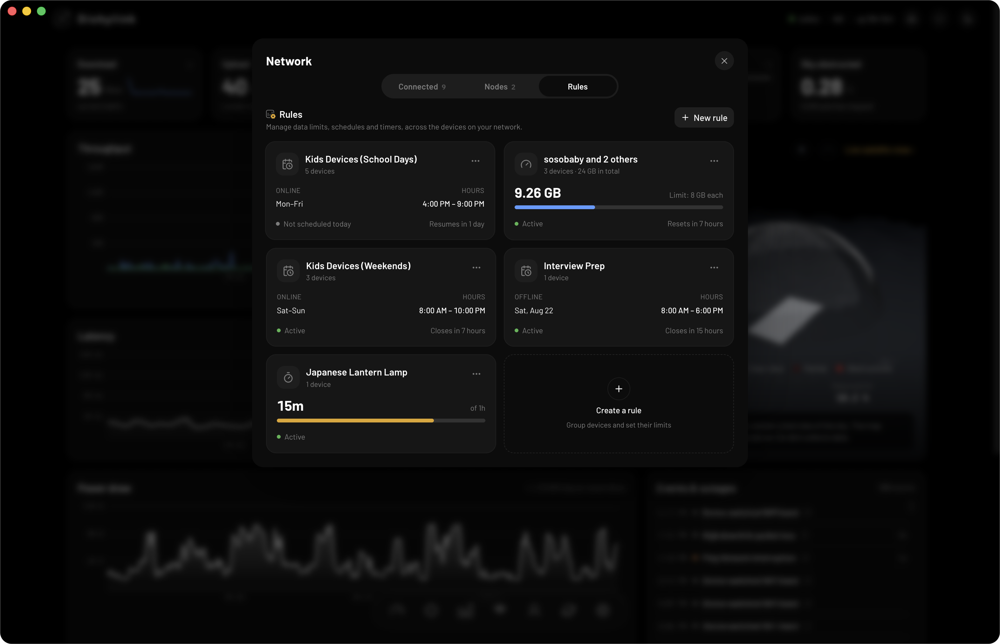

There is a Starlink app for Windows. It is called Dishylink, and it is free. It runs on Windows 10 and Windows 11 and shows your Starlink speed, latency, outages, data usage and connected devices on your PC.

SpaceX does not make a Windows app. The official Starlink app is available for iPhone, iPad and Android only. This guide explains how to use Dishylink on Windows and covers the other ways to manage Starlink from a computer.

Dishylink is our app. The details about Starlink's own pages were checked on a Starlink dish in November 2026.

## Quick summary

- The official Starlink app is not available for Windows.
- Dishylink is a free Starlink app for Windows 10 and 11. It works over your local network and does not need a Starlink account.
- Your dish has a basic status page at `192.168.100.1`.
- Billing, plan changes and support are handled at starlink.com.

## 5 ways to manage Starlink on Windows

| Method                            | What it is                                 | Best for                            |
| :-------------------------------- | :----------------------------------------- | :---------------------------------- |
| 1. Dishylink                      | A free desktop app for Windows 10 and 11   | Monitoring, history and control     |
| 2. The dish status page           | A page your dish serves at `192.168.100.1` | Checking that the dish is online    |
| 3. Your Starlink account          | starlink.com in any browser                | Billing, plan and support           |
| 4. The Android app in an emulator | The phone app running in a window          | A setting only the official app has |
| 5. Command-line tools             | Open-source scripts                        | Building your own dashboards        |

## 1. Dishylink (recommended)

[Dishylink](/) is a free, open-source desktop app for Windows. It connects to your dish and router directly over your home network. It does not need an account, and the data it records stays on your PC.

A Starlink dish only stores the last few minutes of its own history. Dishylink records continuously, so you can review your connection by day, week or month.

### What Dishylink shows

- Download and upload speed, latency, power draw, ping success and sky obstruction, updated live
- Recorded history for each of those, by day, week and month
- Starlink latency and router latency on the same chart, so you can see where a delay comes from
- Every device on your network, with its Wi-Fi band, signal strength and data usage for the billing month
- Alerts when the dish or router stops responding, overheats or is affected by weather
- Your obstruction map and a live view of the satellites overhead

### What you can control

- Snow melt: automatic, always on or off
- Sleep schedule: power the dish down for part of every day
- Software updates: choose the time window for update reboots, or defer updates for up to 3 days
- Maintenance: reboot the dish, reset the obstruction map, stow or unstow motorised kits, and factory reset
- Router: Wi-Fi network names and bands, custom DNS, bypass mode, router reboot and factory reset
- Devices: pause and unpause any device on your network

### Network rules

- Data limits for one device or a group of devices
- Schedules that allow a device online only during set hours
- Timers that give a device access for a set length of time

### Windows features

- Windows notifications for alerts, even when the app window is closed
- Live download and upload speed in a small display that stays on top of other windows. Turn it on with Show Throughput in Taskbar in the tray icon's menu.
- Runs in the system tray and keeps recording after you close the window
- Can start with Windows
- Updates itself

### How to install Dishylink on Windows

1. [Download Dishylink for Windows](/#get). Choose the Universal installer unless you need the x64 or ARM64 build.
2. Run the installer.
3. Connect your PC to your Starlink network.
4. Open Dishylink.

### Limitations

- First-time setup of a new Starlink kit still requires the official Starlink app.
- Some controls, including pausing devices and network rules, require signing in to your Starlink account. Monitoring works without an account.

## 2. The dish status page (192.168.100.1)

Starlink dishes used to serve a full web portal at this address. Starlink abandoned it in 2024. A small diagnostics page is all that remains.

### How to open it

1. Connect your PC to your Starlink network.
2. Open a browser.
3. Go to `http://192.168.100.1`.

### What the page shows

On a dish running the October 2026 software, the page shows:

- Whether the dish is online
- Uptime
- Alignment (rotation and tilt)
- The obstruction map
- The software version
- A Reboot button

The page also displays a message recommending the Starlink app for more features.

### What the page does not show

- Speed or latency
- Data usage
- History
- Wi-Fi settings

If you use your own router with Starlink in bypass mode, you may need to add a route to `192.168.100.1` on that router before the page will open.

## 3. Your Starlink account (starlink.com)

You can sign in to your Starlink account at starlink.com from any browser on Windows. The account pages cover your plan, billing and payment details, orders and support.

The account pages do not show live information about your dish or your home network.

## 4. The Android app in an emulator

Android emulators such as BlueStacks run Android apps on Windows. Some people use an emulator to run the official Starlink app on a PC. We have not tested this method.

### Things to consider

- The app keeps its phone layout inside a window.
- The emulator must be configured so that the app can reach your dish on the local network.
- An emulator is a large program to install for one app.

SpaceX does not publish a Starlink installer for Windows. Be careful with websites that offer one.

## 5. Command-line tools

[starlink-grpc-tools](https://github.com/sparky8512/starlink-grpc-tools) is a set of open-source Python scripts that read the dish's local data. The scripts can output text or CSV, or send the data to InfluxDB, SQLite, MQTT or Prometheus.

The tools do not have a graphical interface. You build the charts yourself, usually with Grafana. This option suits people who already run their own monitoring system.

## Which option is best?

- For everyday monitoring and control on a PC, use Dishylink.
- To check that the dish is online, open `192.168.100.1`.
- For billing, plan changes and support, use starlink.com.
- For a setting that is only in the official app, use the Starlink app on a phone or tablet.

## Frequently asked questions

### Is there a Starlink app for Windows?

Yes. Dishylink is a free desktop app for Windows 10 and 11. SpaceX's official Starlink app is only available for iPhone, iPad and Android.

### Do I need an app to use Starlink on a PC?

No. A PC connects to Starlink over Wi-Fi or Ethernet like any other network. An app is only needed to monitor the connection or change settings.

### Why won't 192.168.100.1 open?

The page only works from inside your Starlink network. Check that your PC is not connected to a different Wi-Fi network or a mobile hotspot, and turn off any VPN. If you use your own router with Starlink in bypass mode, the router may need a route to the dish's address.

### Is Dishylink safe to install?

Dishylink is open source, and the code is available on [GitHub](https://github.com/DaveyHert/dishylink). It communicates with your dish and router on your own network and does not send telemetry.
