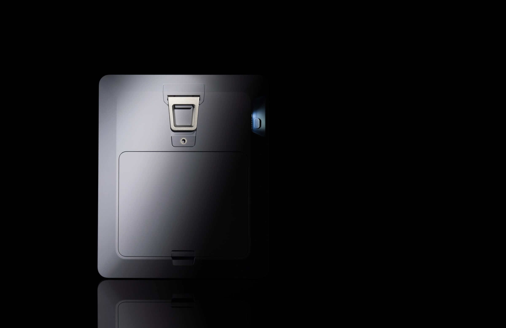
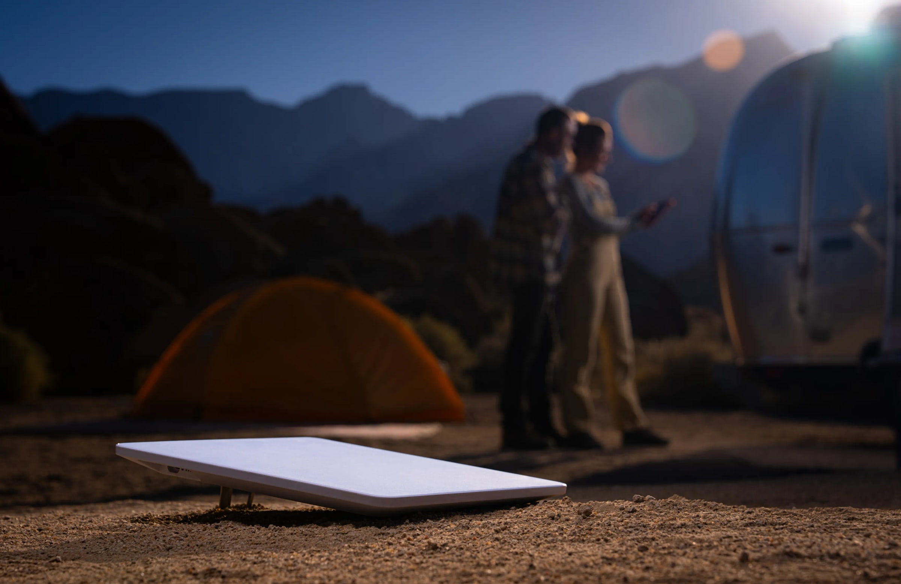

The Starlink Mini has always had one catch. The dish is small enough to carry in a backpack, but it has no battery, so it only works where you can plug it in. For most people that has meant bringing a power bank along, or running a cable from the car.

Starlink has now dealt with that. On November 10, 2026, SpaceX announced the Starlink Mini 2, a new version of the dish with a battery built in. It runs for up to 4.5 hours on a charge, and the battery comes off so you can swap in a spare.

We think it is the upgrade the Mini needed most. It is the first Mini you can take somewhere with no power at all and still get online. The catch this time is the price, and the fact that most people cannot order one yet.

## What is new in the Mini 2

The battery is the big change, but it is not the only one. Starlink has also made the dish thinner, moved it to USB-C and upgraded the Wi-Fi.

_Image Credit: Starlink_

The main changes in the Mini 2:

- The battery lasts up to 4.5 hours and has a capacity of 71 Wh.
- The battery has a quick release, so a spare can be swapped in. Spare batteries are sold separately.
- The dish charges over USB-C at 60 W and stays online while the battery charges.
- Wi-Fi 6 is built in and covers up to 1,800 square feet (167 square metres).
- The dish is 23.1 mm thick and weighs 1.6 kg with the battery and kickstand.
- The dish is rated IP67 for dust and water.

Setup has not changed much. Starlink says the Mini 2 gets online in about 60 seconds once it is pointed at the sky.

## How much it costs and who can buy it

This is the less exciting part. Starlink has not announced an official price for the Mini 2, and for now you need an invitation to order one.

According to online sources, the invitations sent to US customers offer the Mini 2 for $999 plus tax, with 12 months of Roam Unlimited service included. Buyers pay a $100 deposit to reserve a dish and the remaining $899 when it ships, which is expected to be in mid-December.

That is a lot more than the original Mini cost, but most of it is the year of service. What the dish costs on its own is still unknown. Online sources also report a Mini 2 beta kit at $249 and a spare battery at $50, found in the code of Starlink's website. Starlink has not confirmed either price.

_Image Credit: Starlink_

## What we still don't know

Starlink has left a few things out of the announcement:

- A price for the dish on its own
- Prices outside the United States
- A date for general sale
- Download and upload speeds
- How much power the dish uses

Starlink says the Mini 2 is "coming soon to more customers and countries". You can sign up for updates on the [Starlink website](https://starlink.com/mini-2).

We have put the full specifications and a comparison with the original Mini in our [Starlink Mini 2 price, specs and release date guide](/blog/starlink-mini-2-price-specs-release-date/).
