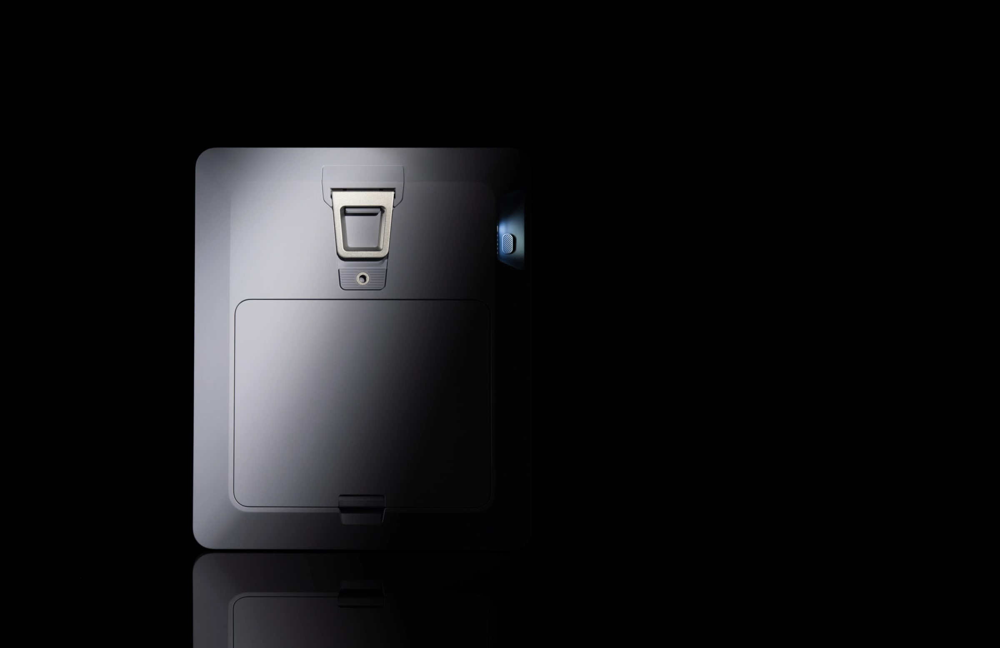
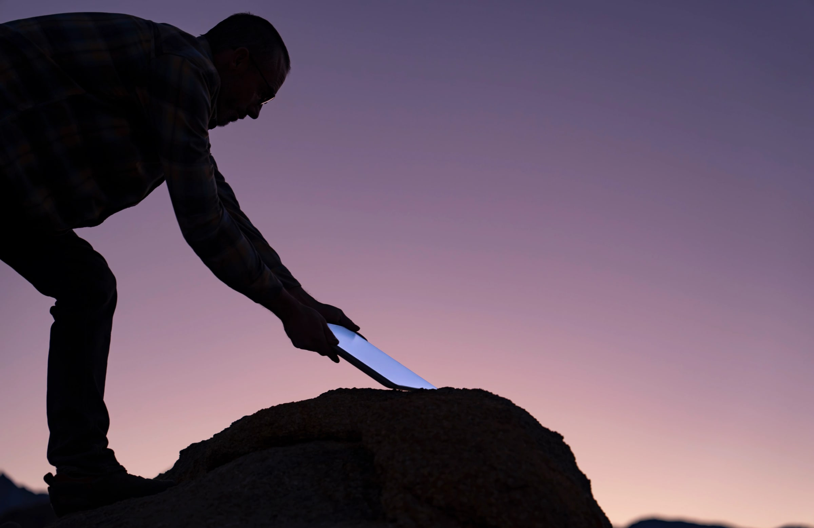

Starlink has given the Mini a battery. The Mini 2, announced on November 10, 2026, can run for up to 4.5 hours without being plugged in, which is the one thing the original Mini could not do.

That makes it an easy dish to like if you camp, travel in a van or live somewhere the power goes out. It is also a confusing launch. The only price so far is a $999 bundle that includes a year of service, you need an invitation to order one, and Starlink has not said what the dish will cost on its own.

We have gone through what Starlink has announced and what has been reported since. This guide covers the price, the release date, the specs and the battery, and what is still unknown.

## Quick summary

- Price: $999 plus tax by invitation in the US, with 12 months of Roam Unlimited included. Starlink has not announced a price for the dish on its own.
- Release date: preorders are open by invitation, and the first dishes are expected to ship in mid-December 2026. There is no date for general sale.
- Battery: up to 4.5 hours, 71 Wh, removable.
- Wi-Fi: Wi-Fi 6, covering up to 1,800 square feet (167 square metres).
- Size: 263 × 314 × 23.1 mm, and 1.6 kg with the battery and kickstand.

## How much does the Starlink Mini 2 cost?

The price is the part of this launch that needs explaining. Starlink has not announced an official price for the Mini 2 on its own. The only price so far is the preorder offer sent to selected US customers.

What the preorder offer includes, according to online sources:

- $999 plus tax for the Mini 2 kit and 12 months of Roam Unlimited service
- A year of service that Starlink values at $2,100
- A refundable $100 deposit to reserve a dish
- The remaining $899 plus tax charged when the dish ships
- A new service line, as the kit cannot be added to an existing one

So $999 is not the price of the dish. Most of it is the year of service, and if you were going to pay for Roam Unlimited anyway, the bundle works out well.

Prices that have been reported but not confirmed:

- $249 for a Mini 2 beta kit
- $50 for a spare battery

Both figures were found in the code of Starlink's website. Starlink has not confirmed them, so we would not plan a purchase around them yet.

## When can you buy the Starlink Mini 2?

For most people, not yet. Starlink has not given a date for general sale. This is what is known:

- November 10, 2026: Starlink announced the Mini 2 and opened preorders by invitation to selected US customers.
- Mid-December 2026: the first dishes are expected to ship.
- Other countries: Starlink says the Mini 2 is "coming soon to more customers and countries", with no date.

You can sign up for updates on the [Starlink website](https://starlink.com/mini-2).

## Starlink Mini 2 specs

| Specification        | Starlink Mini 2                                |
| -------------------- | ---------------------------------------------- |
| Battery life         | Up to 4.5 hours                                |
| Battery capacity     | 71 Wh                                          |
| Battery weight       | 490 g (1.08 lb)                                |
| Charging             | USB-C, 60 W                                    |
| Wi-Fi                | Wi-Fi 6, up to 1,800 square feet (167 m²)      |
| Dimensions           | 263 × 314 × 23.1 mm (10.35 × 12.36 × 0.91 in)  |
| Weight               | 1.6 kg with battery and kickstand              |
| Field of view        | 110°                                           |
| Environmental rating | IP67                                           |
| Mounting             | Kickstand, and a standard 1/4-20 camera thread |

Starlink has not published download speeds, upload speeds or power consumption for the Mini 2.

## How long does the battery last?

_Image Credit: Starlink_

Up to 4.5 hours on a charge. That will cover an evening at a campsite or a short power cut. It will not cover a full working day, which is where the spare battery comes in.

What to know about the battery:

- It has a quick release, so you can swap in a spare. Spare batteries are sold separately.
- The dish stays online while the battery charges.
- It charges over USB-C at 60 W.
- It weighs 490 g and has a capacity of 71 Wh.
- It has a USB-C power output of up to 60 W.

You do not have to use the battery at all. The Mini 2 also runs on USB-C power, where the original Mini needs its DC power cable.

## What is in the box

- Starlink Mini 2
- Battery
- Kickstand
- USB-C power supply, 60 W
- USB-C to USB-C cable, 3 m (10 ft)

## Starlink Mini 2 vs the original Mini

_Image Credit: Starlink_

The Mini 2 is thinner than the original, but it is not lighter. The battery adds weight, so the Mini 2 comes in at 1.6 kg with its battery and kickstand, against 1.16 kg for the original with its kickstand.

|                | Starlink Mini 2                   | Original Mini          |
| -------------- | --------------------------------- | ---------------------- |
| Battery        | Built in, up to 4.5 hours         | None                   |
| Power          | Battery or USB-C                  | DC power cable         |
| Wi-Fi          | Wi-Fi 6                           | Wi-Fi 5                |
| Wi-Fi coverage | Up to 167 m²                      | Up to 112 m²           |
| Thickness      | 23.1 mm                           | 38.5 mm                |
| Footprint      | 263 × 314 mm                      | 298.5 × 259 mm         |
| Weight         | 1.6 kg with battery and kickstand | 1.16 kg with kickstand |

If you already own a Mini and a power bank that runs it, the Mini 2 does the same job with less to carry. If you are buying your first portable dish, we would wait for the Mini 2.

## What we still don't know

- A price for the dish on its own
- Prices outside the United States
- The price of a spare battery
- A date for general sale
- Download and upload speeds
- Power consumption
