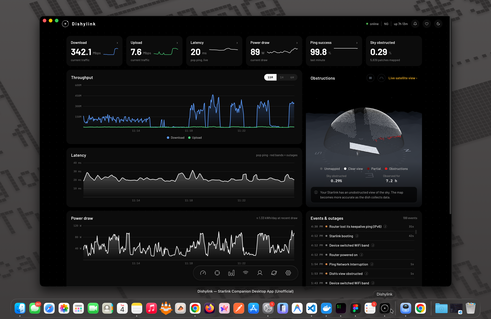

You can monitor Starlink from a Docker container on a Raspberry Pi or a home server. Dishylink runs a full Starlink dashboard and a recorder in a single container, so your connection is recorded continuously.

This matters because a Starlink dish only stores the last few minutes of its own history. To see what happened overnight or compare one month with another, a separate recorder has to run all the time.

This guide explains how to run Dishylink in Docker and compares it with two other container options. Dishylink is our app. The details about the other two come from their documentation as of November 2026.

## Quick summary

- Dishylink runs a Starlink dashboard and recorder in one container.
- starlink-grpc-tools exports Starlink data to a database such as InfluxDB.
- A Prometheus exporter provides Starlink metrics for Prometheus and Grafana.
- All three need the Docker host to be on your Starlink network.

## Requirements

- Docker with Docker Compose
- A computer connected to your Starlink network. The dish only responds at `192.168.100.1` from inside that network.
- For a Raspberry Pi: a Pi 4 or Pi 5 with the 64-bit OS and 4 GB of memory

## 3 ways to monitor Starlink with Docker

| Method                   | What you get                        | Best for                           |
| :----------------------- | :---------------------------------- | :--------------------------------- |
| 1. Dishylink             | A dashboard and recorder            | A ready-made dashboard             |
| 2. starlink-grpc-tools   | Scripts that export the dish's data | An existing InfluxDB or MQTT setup |
| 3. A Prometheus exporter | Metrics for Prometheus              | An existing Prometheus and Grafana |

## 1. Dishylink (recommended)

[Dishylink](/) is a free, open-source Starlink app. Its container includes the web dashboard and the history recorder.

### How to run Dishylink in Docker

1. Clone the repository and start the container:

   ```sh
   git clone https://github.com/DaveyHert/dishylink.git
   cd dishylink
   docker compose up --build
   ```

2. Open `http://localhost:8080` in a browser.
3. To open the dashboard from another device on your network, use the host's IP address with port 8080.

### What you get

- The full Dishylink dashboard: speed, latency, power draw, ping success, sky obstruction, the obstruction map and connected devices
- The same dish and router controls as the desktop app
- Continuous recording, with history by day, week and month
- History stored in a Docker volume, so it is kept across restarts and rebuilds



### Notes

- There is no prebuilt image. Docker Compose builds the image on your machine, which takes a few minutes the first time.
- The image builds for amd64 and arm64. This covers a standard PC, an Apple silicon Mac and a 64-bit Raspberry Pi.
- On Docker Desktop, do not enable host networking. The published port is sufficient.
- Run only one recorder on a network. If the Dishylink desktop app is already recording, a second recorder doubles the requests to your router.

## 2. starlink-grpc-tools

[starlink-grpc-tools](https://github.com/sparky8512/starlink-grpc-tools) is a set of open-source Python scripts that read the dish's local data. The project publishes a container image for amd64 and arm64:

```sh
docker pull ghcr.io/sparky8512/starlink-grpc-tools
```

### What it does

- Outputs status as text or CSV
- Sends data to InfluxDB, SQLite, MQTT or Prometheus
- Runs the InfluxDB script by default, which requires an InfluxDB server

The tools do not include a dashboard. You build the charts yourself, usually with Grafana.

## 3. A Prometheus exporter

[starlink_exporter](https://github.com/danopstech/starlink_exporter) is a Prometheus exporter for Starlink. It reads the dish and exposes its metrics on port 9817. The project provides a container image, and its documentation links to a Grafana dashboard.

You need to run Prometheus and Grafana yourself. Check the project's recent activity before relying on it, because Starlink changes its local data from time to time.

## Which option is best?

- For a ready-made dashboard, use Dishylink.
- If you already run InfluxDB or MQTT, use starlink-grpc-tools.
- If you already run Prometheus and Grafana, use a Prometheus exporter.

## Frequently asked questions

### Can I run Starlink monitoring on a Raspberry Pi?

Yes. Dishylink and starlink-grpc-tools both run on arm64. For Dishylink, use a Pi 4 or Pi 5 with the 64-bit OS and 4 GB of memory.

### Does the container need my Starlink login?

No. All three options read the dish over your local network without an account. Dishylink has an optional Starlink account sign-in that adds your plan and billing information.

### Why does the container show no data?

The Docker host is usually not on the Starlink network, or it is connected through a VPN. Open `http://192.168.100.1` in a browser on the host. If the page does not load, the container cannot reach the dish.

### Will it slow down my internet?

No. These tools read small status messages from the dish and router on your local network. Your internet traffic does not pass through them.
