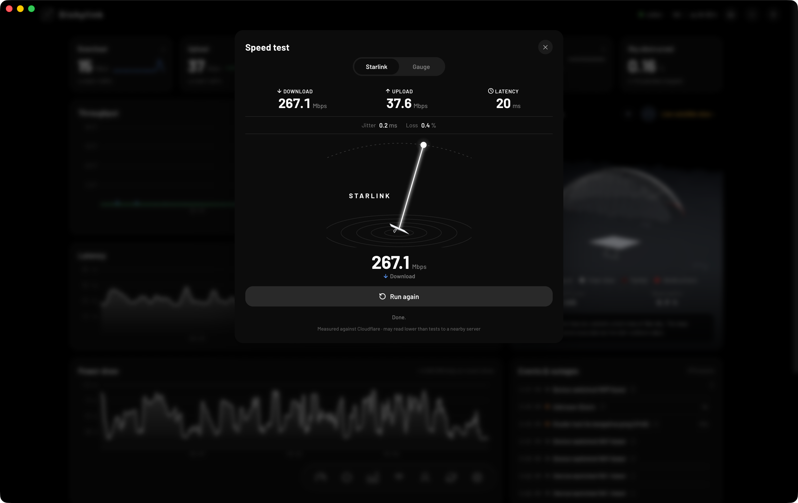
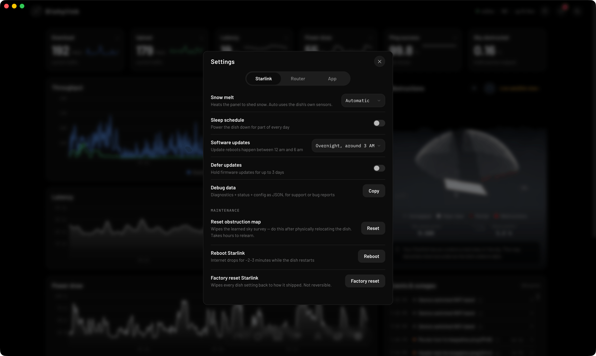
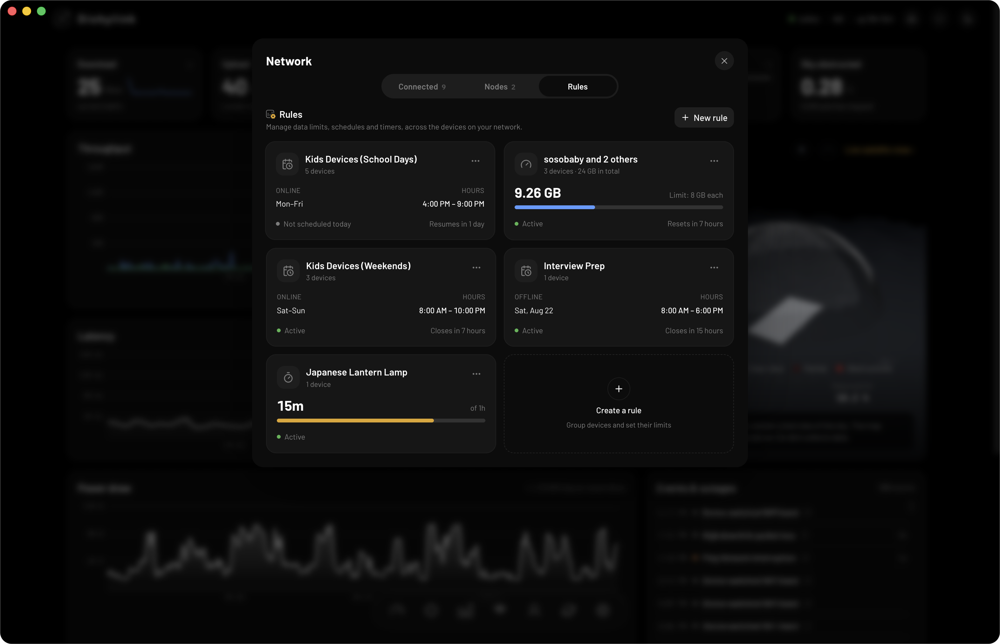

You can use a full Starlink dashboard in your web browser. Dishylink is a free browser extension for Chrome, Edge and Firefox that shows your Starlink speed, latency, obstruction map and connected devices.

Starlink also has two web pages of its own: the status page built into the dish, and your account at starlink.com. This guide explains how to install the Dishylink extension and what each of Starlink's pages is for.

Dishylink is our app. The details about Starlink's own pages were checked in November 2026.

## Quick summary

- The Dishylink extension gives you a full Starlink dashboard in Chrome, Edge or Firefox, with the same monitoring, controls and network rules as the desktop app.
- The dish status page at `192.168.100.1` shows basic status only.
- starlink.com is for billing, plan changes and support.
- You can also run the Dishylink dashboard yourself, from source with `npm run dev` or in Docker.

## 4 ways to use Starlink in a browser

| Method                         | What it is                                 | Best for                            |
| :----------------------------- | :----------------------------------------- | :---------------------------------- |
| 1. Dishylink browser extension | A dashboard in Chrome, Edge or Firefox     | Monitoring and control in a browser |
| 2. The dish status page        | A page your dish serves at `192.168.100.1` | Checking that the dish is online    |
| 3. Your Starlink account       | starlink.com                               | Billing, plan and support           |
| 4. A self-hosted dashboard     | Dishylink run from source or in Docker     | Running the dashboard yourself      |

## 1. The Dishylink browser extension (recommended)

[Dishylink](/) is a free, open-source Starlink app. The browser extension is the same dashboard as the desktop app, opened from your browser's toolbar. It reads your dish and router directly over your home network.

### How to install the extension

1. Open the store page for your browser:
   - [Chrome Web Store](https://chromewebstore.google.com/detail/dishylink/pljgamnkfokhbchiiommnblkjffffnna)
   - [Edge Add-ons](https://microsoftedge.microsoft.com/addons/detail/pknccegejhlgmeiojalenedmkbcaimdo)
   - [Firefox Add-ons](https://addons.mozilla.org/addon/dishylink/)
2. Add the extension to your browser.
3. Connect your computer to your Starlink network.
4. Click the Dishylink icon in the toolbar.

The dashboard opens in its own window. It can also open in an ordinary browser tab.

### What the extension shows

- Download and upload speed, latency, power draw, ping success and sky obstruction, updated live
- Recorded history for each of those
- Every device on your network, with its Wi-Fi band, signal strength and data usage
- Your obstruction map and a live view of the satellites overhead
- A built-in speed test
- Alerts, with browser notifications even when the dashboard is closed
- The number of active alerts, as a badge on the toolbar icon



### What you can control

- Snow melt: automatic, always on or off
- Sleep schedule: power the dish down for part of every day
- Software updates: choose the time window for update reboots, or defer updates for up to 3 days
- Maintenance: reboot the dish, reset the obstruction map, stow or unstow motorised kits, and factory reset
- Router: Wi-Fi network names and bands, custom DNS, bypass mode, router reboot and factory reset
- Devices: pause and unpause any device on your network



### Network rules

- Data limits for one device or a group of devices
- Schedules that allow a device online only during set hours
- Timers that give a device access for a set length of time



Some controls, including pausing devices and network rules, require signing in to your Starlink account. Monitoring works without an account. The extension also asks which device in the list is yours, so that it never pauses the computer it is running on.

### Limitations

- The extension records history only while your browser is running. Periods when the browser was closed appear as gaps.
- Chrome must be version 144 or later. Earlier versions have a local network bug that prevents the extension from collecting data.

For continuous recording, use the [Dishylink desktop app](/#get) or a self-hosted dashboard, covered below.

## 2. The dish status page (192.168.100.1)

Starlink dishes used to serve a full web portal at this address. Starlink abandoned it in 2024. A small diagnostics page is all that remains.

### How to open it

1. Connect to your Starlink network.
2. Open a browser.
3. Go to `http://192.168.100.1`.

### What the page shows

On a dish running the October 2026 software, the page shows:

- Whether the dish is online
- Uptime
- Alignment
- The obstruction map
- The software version
- A Reboot button

The page also displays a message recommending the Starlink app for more features. It does not show speed, latency, data usage, history or Wi-Fi settings.

## 3. Your Starlink account (starlink.com)

Sign in at starlink.com to manage your plan, billing and payment details, orders and support. The account pages do not show live information about your dish or your home network.

## 4. A self-hosted dashboard

Dishylink is open source, so you can run the dashboard yourself and open it in any browser. There are two ways to do it. In both cases the computer must be on your Starlink network.

### Run it from source

1. Install Node.js 22.
2. Clone the repository and install its dependencies:

   ```sh
   git clone https://github.com/DaveyHert/dishylink.git
   cd dishylink
   npm install
   ```

3. Start the dashboard:

   ```sh
   npm run dev
   ```

4. Open `http://localhost:5173` in your browser.

### Run it in Docker

Docker packages the same dashboard with the history recorder in one container. This suits a computer that stays on, such as a Raspberry Pi, because it records continuously and any device on your network can open the dashboard.

See our [guide to running Starlink monitoring in Docker](/blog/starlink-monitoring-docker/) for the setup steps.

## Frequently asked questions

### Is there a Starlink web app?

Yes. The Dishylink extension provides a full dashboard in Chrome, Edge and Firefox. Starlink's own web pages are the account site at starlink.com and the basic status page built into the dish.

### Can I set up Starlink from a browser?

First-time setup is designed for the Starlink app on a phone or tablet. A browser is used to monitor and manage a dish that is already set up.

### Why won't 192.168.100.1 open?

The page only works from inside your Starlink network. Check that you are not connected to a different Wi-Fi network or a mobile hotspot, and turn off any VPN. If you use your own router with Starlink in bypass mode, the router may need a route to the dish's address.

### Does the Dishylink extension track me?

No. The extension has no telemetry, analytics or tracking. It reads your dish and router on your own network, and the data it records stays in your browser. The code is available on [GitHub](https://github.com/DaveyHert/dishylink).
