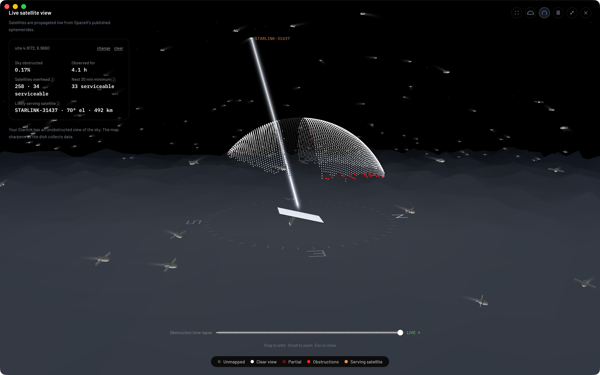

You can find the Starlink satellite your dish is connected to with Dishylink. Its live satellite view shows the sky above your dish in 3D and marks the satellite your dish is most likely using, with its name.

Starlink does not show this information. The official Starlink app displays your connection statistics and obstruction map, but not the satellite in use. The dish's status page does not show it either.

This guide explains why the satellite is hard to identify and describes three ways to find it. Dishylink is our app.

## Quick summary

- A Starlink dish switches to a different satellite about every 15 seconds.
- The dish does not report which satellite it is using, so the answer has to be calculated.
- Dishylink's live satellite view calculates the likely satellite and shows it in real time.
- You can also estimate it with a live satellite map, or work it out from the obstruction map.

## Why Starlink does not show the satellite

### The satellite changes every 15 seconds

A Starlink satellite crosses your sky in a few minutes. The network moves each dish from one satellite to the next on a shared 15-second schedule.

### The dish does not report it

The data a dish shares on your network includes speed, latency, obstructions, alignment and alerts. It does not include the satellite in use.

Any tool that names your satellite calculates it from three things: your location, the position of every satellite, and the parts of your sky that are obstructed.

## 3 ways to find your Starlink satellite

| Method                           | Accuracy           | Effort                         |
| :------------------------------- | :----------------- | :----------------------------- |
| 1. Dishylink live satellite view | A careful estimate | Open the app                   |
| 2. A live satellite map          | A rough estimate   | Compare the map with your dish |
| 3. The obstruction map method    | The most accurate  | Repeated captures and matching |

## 1. Dishylink live satellite view (recommended)

[Dishylink](/) is a free, open-source Starlink app for Mac, Windows and browsers. Its satellite view shows the satellites above your dish and identifies the one most likely serving you.

### How to open the satellite view

1. [Download Dishylink](/#get) and open it while connected to your Starlink network.
2. On the dashboard, click Live satellite view on the Obstructions panel.
3. Set your location. You can paste coordinates, use your browser's location, or use a city-level estimate.

### What the satellite view shows

- Every Starlink satellite currently overhead, moving in real time
- A beam from your dish to the likely serving satellite, with its name (for example, `STARLINK-31437`)
- The satellite's elevation and distance
- The number of satellites overhead, and how many your dish could use
- Your obstructions, drawn on the same dome
- Pass details for any satellite you click

### How Dishylink identifies the satellite

1. It loads the orbit of every Starlink satellite. SpaceX supplies this data and CelesTrak publishes it.
2. It uses your location to calculate where each satellite is in your sky.
3. It excludes satellites that are too low. A dish uses satellites above roughly 25 degrees of elevation.
4. It excludes satellites that are behind an obstruction in your obstruction map.
5. It selects the highest remaining satellite.
6. It repeats the selection every 15 seconds, matching Starlink's handoff schedule.

The app labels the result "Likely serving satellite" because it is an estimate. The dish does not confirm which satellite it is using.

### Why Dishylink needs your location

Since May 2026, dishes on residential plans no longer share their GPS position with apps on your network. Dishylink asks for your location once and stores it on your computer.

## 2. A live satellite map

You can make a rough estimate without installing anything.

### Steps

1. Open a live satellite map such as [satellitemap.space](https://satellitemap.space) and find your location.
2. Look at the Starlink satellites passing overhead.
3. Check the direction your dish faces. The alignment is shown in the Starlink app and on the dish status page at `http://192.168.100.1`.
4. Find the highest satellite in the part of the sky your dish faces.

### Limitations

- The map shows where satellites are, not which one your dish is using.
- The map does not know about your obstructions.
- The satellite changes every 15 seconds.

## 3. The obstruction map method

This method is accurate but slow. It is the method [researchers have used](https://arxiv.org/abs/2307.00402) to study how Starlink assigns satellites.

While a satellite serves your dish, the dish records the path it tracked across the sky. That path appears as a new trail in the obstruction map. Matching the trail to the published satellite orbits identifies the satellite.

To use this method, you need to capture the obstruction map repeatedly and do the matching yourself. [starlink-grpc-tools](https://github.com/sparky8512/starlink-grpc-tools) can save the obstruction map as images.

## Frequently asked questions

### Does the Starlink app show which satellite I am connected to?

No. The Starlink app shows connection statistics and your obstruction map, but not the satellite in use.

### How often does a Starlink dish switch satellites?

About every 15 seconds. The switches follow a schedule shared by every dish.

### How many Starlink satellites are above me?

The number depends on your location and changes constantly. Dishylink's satellite view shows how many satellites are overhead and how many are high enough for your dish to use.

### Does knowing the satellite help fix a bad connection?

Not directly, because you cannot choose your satellite. It helps you understand obstructions. If your connection drops each time the likely satellite passes behind the same tree, you know what to trim or where to move the dish.
